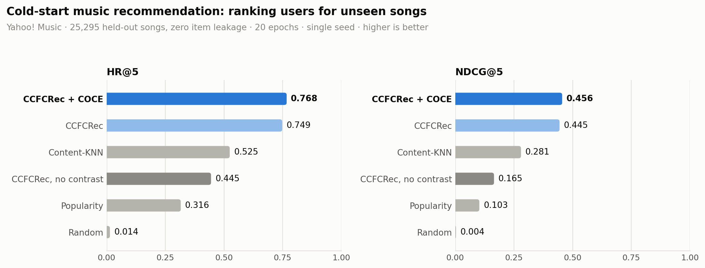
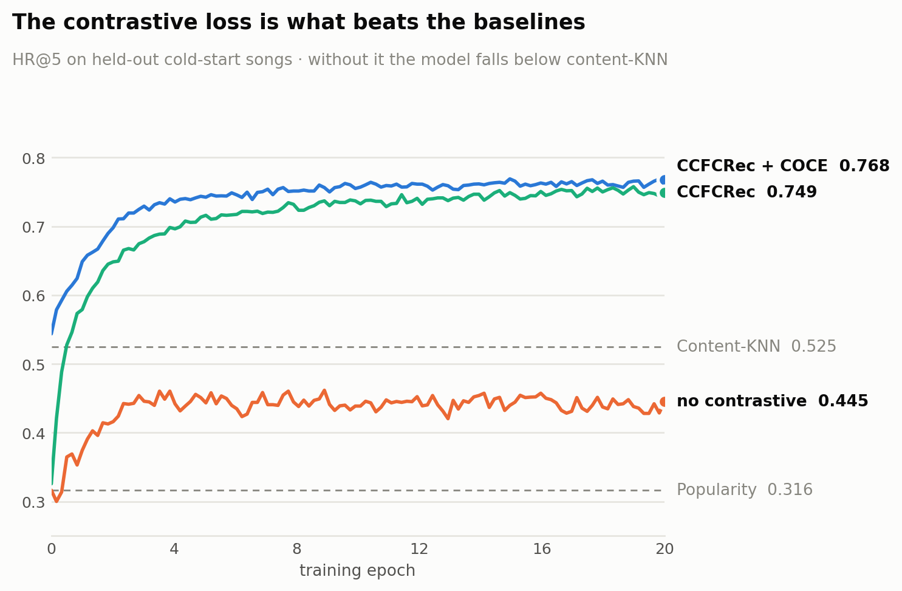
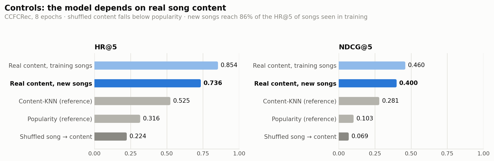

# Addressing the Blurry Collaborative Embedding Problem for Cold-Start Music Recommendation

Course project for **Recommender Systems and Graph Machine Learning (DS535)**, KAIST.
An implementation of **CCFCRec** ([Zhou, Zhang & Yang, WWW '23](https://doi.org/10.1145/3543507.3583286))
applied to music recommendation on the Yahoo! Music dataset.



## Abstract

A recommender learns what a song is like from who listens to it, so a **newly
released song carries no collaborative signal at all**. The standard remedy,
mapping item content onto collaborative embeddings, has a built-in flaw: songs
sharing an attribute get pulled in opposite directions during training and
collapse onto a blurred average.

This project implements CCFCRec on **1M Yahoo! Music interactions** and evaluates
it on a **strict cold-start split** where 25,295 songs are held out entirely
(zero item leakage), ranking users for each unseen song.

**CCFCRec reaches HR@5 = 0.768 and NDCG@5 = 0.456: 1.46× a content-KNN
baseline and 54× random.** An ablation isolates why: removing the contrastive
objective costs 41% of HR@5 and drops the model *below* the KNN baseline,
confirming the paper's central claim on this dataset. Restoring the paper's
co-occurrence encoder (COCE) performs on par with a free per-item embedding
table while using **3.7× fewer parameters**. Two controls confirm the model
relies on real song content: shuffling which content belongs to which song
drops HR@5 to 0.224, below a popularity ranking.

| | HR@5 | NDCG@5 | vs. KNN |
|---|---|---|---|
| Content-KNN | 0.5250 | 0.2805 | - |
| CCFCRec | 0.7487 | 0.4448 | +43% |
| **CCFCRec + COCE** | **0.7677** | **0.4559** | **+46%** |

## Problem

A recommender learns what an item is like from who has listened to it. A **new
song has no listeners**, so it has no collaborative signal at all: the
cold-start problem. The usual fix is to learn a mapping from item *content*
(genre, artist, album) to a collaborative embedding, trained on warm items.

That fix has a built-in flaw, which the paper calls the **blurry collaborative
embedding** problem. During training, two songs that share an attribute, say
both are *Electronic*, push that attribute's embedding in opposite directions
whenever one is a positive example and the other a negative. The attribute
embedding settles on a blurred average, and content-identical songs end up with
identical embeddings even when their real audiences are completely different.

This dataset is a hard case for exactly that reason: each song carries only
**3 active attributes out of 216** (genre, parent genre, grandparent genre), so
thousands of songs are content-identical.

## Method

CCFCRec sharpens the content embedding using co-occurrence information that is
available for warm items:

| module | produces | available for cold items? |
|---|---|---|
| **CBCE** (content) | `q_v`, attention over attribute embeddings + artist/album | yes |
| **COCE** (co-occurrence) | `z_v = W_v · v`, from the multi-hot vector of the item's listeners | warm only |

A **contrastive loss** aligns the two. Positives for item `v` are items sharing
at least one listener (`N_v⁺ = {v⁺ : U_v ∩ U_v⁺ ≠ ∅}`); negatives are the rest.
The co-occurrence knowledge transfers into the content tower during training, so
at inference a cold item, where only CBCE exists, still produces a
discriminative embedding.

$$\mathcal{L} = \mathcal{L}_q + \mathcal{L}_z + \lambda\mathcal{L}_c + \lVert\Theta\rVert$$

`L_q`, `L_z`: BPR ranking losses · `L_c`: contrastive loss · `λ = 0.6`


*Figure adapted from Zhou, Zhang & Yang (2023).*

## Data and evaluation protocol

Yahoo! Music R2, subsampled to **1,000,000 interactions / 2,677 users / 126,478 songs**.
Item metadata: genre hierarchy (216 nodes), artist id, album id.

`prep_cold_split.py` builds a **genuine cold-start item split**: 20% of songs
are held out *entirely*, so no test song appears in training:

```
train : 804,910 rows  2,677 users  101,183 songs
test  : 195,089 rows  2,676 users   25,295 songs
item leakage: 0
```

Following the paper, evaluation **ranks users for each cold item** (who should
this new song be shown to?) and reports HR@k and NDCG@k for k ∈ {5, 10, 20}.

## Results

Cold-start split, 3,000 sampled test items, 20 epochs, `dim=64`, identical
metric code for every row. Model rows are a single training run each.

| | HR@5 | HR@10 | HR@20 | NDCG@5 | NDCG@10 | NDCG@20 |
|---|---|---|---|---|---|---|
| random | 0.0143 | 0.0283 | 0.0510 | 0.0035 | 0.0042 | 0.0058 |
| popularity | 0.3163 | 0.4507 | 0.5733 | 0.1028 | 0.1180 | 0.1368 |
| content-KNN (k=50) | 0.5250 | 0.6163 | 0.6970 | 0.2805 | 0.2932 | 0.3145 |
| CCFCRec, no contrastive (λ=0) | 0.4453 | 0.5843 | 0.7077 | 0.1654 | 0.1832 | 0.2135 |
| CCFCRec | 0.7487 | 0.8100 | **0.8667** | 0.4448 | 0.4452 | 0.4652 |
| **CCFCRec + COCE** | **0.7677** | **0.8190** | 0.8640 | **0.4559** | **0.4568** | **0.4765** |



**Ablation: the contrastive loss is what makes the method work.** Removing it
costs 41% of HR@5 and 63% of NDCG@5, and drops the model *below* a plain
content-KNN baseline. This is the paper's central claim, and it holds here.

**COCE is as good with far fewer parameters.** Replacing the free per-item
lookup table with the paper's co-occurrence encoder scores slightly higher on
5 of 6 metrics while using **3.7× fewer parameters** (2.30M vs 8.60M), since the
item table shrinks from `n_items × d` to `n_users × d`. With one run per model,
the 0.02 HR@5 gap may be within run-to-run noise, so we read it as parity, not
a win.

### Controls

Two checks that the numbers above come from what the method claims to use
(CCFCRec, 8 epochs, same split and metric code):



| | HR@5 | NDCG@5 |
|---|---|---|
| shuffled song → content | 0.2237 | 0.0693 |
| real content, new (cold) songs | 0.7357 | 0.4004 |
| real content, songs seen in training | 0.8543 | 0.4604 |

**Shuffled content.** Reattaching every content vector to a random song keeps the
content self-consistent but cuts its link to the audience. HR@5 falls to 0.224,
below popularity, so the model's accuracy comes from real song content, not
from an artefact of the split or the metric.

**Warm vs cold.** Scoring 3,000 training songs on their training listeners
through the same content-only path measures how much the model memorises. New
songs reach 86% of the warm HR@5: the content tower generalises, but a real
warm–cold gap remains.

## Usage

```bash
python prep_cold_split.py                  # build the cold-start split
python knn_baseline.py --k 50              # content-KNN baseline
bash run_controls.sh                       # shuffled-content and warm-vs-cold controls

python model.py --train_path data/train_cold.csv --valid_path data/test_cold.txt \
                --dim 64 --epoch 20 --num_workers 6 --coce
```

Useful flags: `--coce` (paper's co-occurrence module), `--lambda1 0` (ablate the
contrastive loss), `--dim`, `--eval_items 0` (evaluate on all cold items),
`--shuffle_content` / `--warm_path` (controls).

Dataset: [Yahoo! Music R2](https://drive.google.com/file/d/1NFe0jWa-RdP9wcSGRe6KXMbR0ENXlr_B/view).
Requires `torch`, `pandas`, `numpy`, `scipy`, `scikit-learn`, `tqdm`.

## Limitations

`dim=64` rather than the paper's 256; single run per model; the controls ran 8 epochs
rather than 20; attribute attention is item-independent (`z_v` in `forward()`
does not depend on the item except through the mask); validation uses a fixed
3,000-item subsample unless `--eval_items 0`.

## Contributors

- **Mahsa Aghazadeh** (KAIST, GSDS)
- **Karin Rizky Irminanda** (KAIST, ISysE)
- **Dewei Zhu** (KAIST, ISysE)
- **Anurag Yadav** (KAIST, GSDS)
